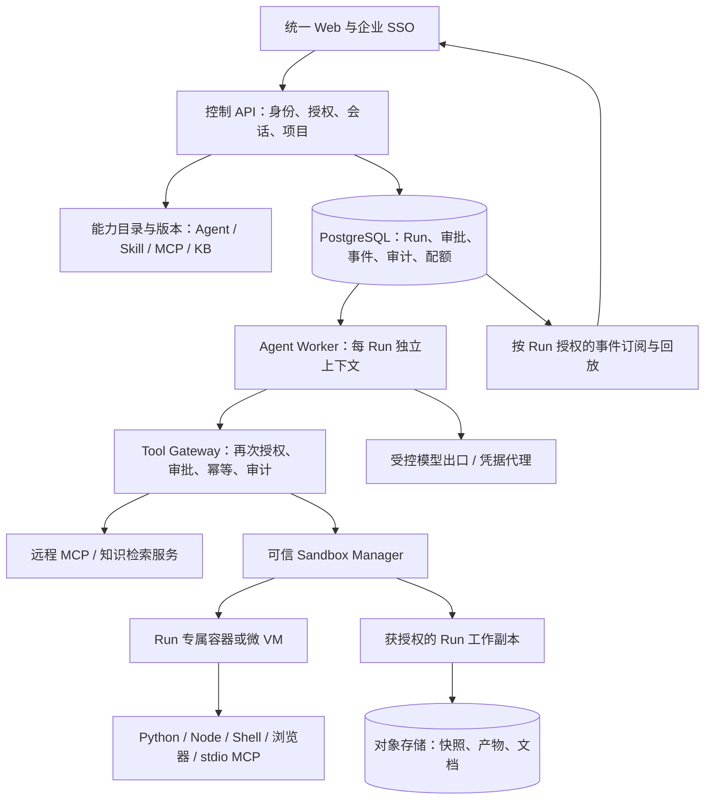

# 企业多部门 Agent 平台实施总计划

> 实施已开始：规划文档的“待实施”是设计基线状态；实际完成/未完成范围及可复现测试见 [实现进度](../../implementation/README.md)。目前尚未满足全平台生产放行。

> 状态：设计与实施计划，尚未实现。基线：仓库提交 `1164d95`，静态核查日期 2026-09-10。  
> 目标项目：`aio-agent-runtime`。输入：现有源码、Compose、测试与工程文档，以及用户提供的架构图。  
> 本轮只增加规划文档，不修改业务代码，不代表通过了容器隔离测试、安全审计、性能测试或生产验收。

## 1. 结论与推荐路线

建设一个统一管理、按权限共享能力、按任务隔离执行的企业 Agent 平台。**复用当前 Local Harness 作为第一版编排引擎，不把它直接部署成多用户平台；先补身份、持久任务和执行隔离，再建设完整能力管理。**

推荐基线：

1. 同一公司作为一个组织边界，部门、项目、个人是组织内授权范围，不把部门或 Session 直接等同于租户。
2. 统一 Web 与企业 SSO；业务人员无需在本地安装 Agent、Docker 或 MCP。
3. 模块化 FastAPI 控制后端 + 独立任务 Worker + 独立可信 Sandbox Manager。第一版不把每个逻辑模块都拆成微服务。
4. PostgreSQL 保存权威状态；Redis 用于通知、缓存和限流，不承担唯一的任务、审批、计费事实来源。
5. 一个 Run 表示一次用户任务，包含多轮推理与多次工具调用。需要本地执行时，惰性创建专属沙箱；同一 Run 内复用，结束后销毁。
6. 知识库问答、纯远程只读 MCP 调用不强制创建代码沙箱；文档解析等不可信文件处理仍要进入隔离任务。
7. Workspace 是持久数据，不是隔离机制；仅将获授权的单个工作副本挂载进该 Run 的沙箱。
8. Skill 统一版本化发布；MCP 共享目录但不共享高权限身份；知识库集中检索但按文档权限过滤。
9. 不允许从控制服务运行用户代码、`stdio MCP`、浏览器 CLI、依赖安装命令；这些进入对应隔离执行单元。
10. Codex App Server 作为第二阶段候选引擎，通过统一 EngineAdapter 接入，不能替代平台鉴权和沙箱。其兼容性、实验接口和部署条款须单独验证。
11. 首版采用 Linux 执行节点。现有 Windows 启动脚本继续作为单机开发入口，不作为生产隔离实现。
12. 允许可信模板先走受控容器试点；任意来源代码/Skill 的开放必须经过更强隔离选型与测试，不以普通 Docker 绝对安全为前提。

一句话：**共享的是能力和管理入口，不是所有人的可写操作系统环境。**

## 2. 阅读导航

| 文档 | 主要回答的问题 | 推荐读者 |
|---|---|---|
| [01 现状核查与差距](01-current-state-and-gaps.md) | 当前哪些可复用，哪些地方会串用户或绕过沙箱 | 架构、后端、安全 |
| [02 产品范围与需求](02-product-and-requirements.md) | 给谁用、有哪些页面与业务流程、什么算完成 | 产品、研发、业务负责人 |
| [03 架构、数据与接口契约](03-architecture-data-api.md) | 模块怎样协作、表怎样建、Run 怎样恢复、API 怎样定义 | 后端、前端、平台 |
| [04 沙箱与安全设计](04-sandbox-and-security.md) | 如何阻止环境污染、跨用户访问、资源耗尽与执行旁路 | 平台、安全、后端 |
| [05 Skill、MCP、知识库与引擎](05-capabilities-and-engines.md) | 共享能力如何接入、发布、授权，如何接 Codex | 能力开发者、后端 |
| [06 文件级实施任务与排期](06-work-breakdown-and-roadmap.md) | 每项具体改哪里、依赖什么、先做什么、如何验收 | 项目负责人、实施团队 |
| [07 测试、运维、迁移与上线](07-verification-operations-rollout.md) | 如何证明安全、压测、排障、迁移、回滚与上线 | 测试、SRE、安全、负责人 |

建议先读本文件和 01，再按职责深入。06 是执行清单，07 是放行清单；不能只执行开发任务而跳过验收。

### 逐阶段执行细化

已将原 **110 项父任务拆成 718 个带编号子任务**。进入 [P0–P6 阶段执行手册](stages/README.md)，或直接使用 [逐项任务索引](stages/task-index.md)、[子任务依赖与开放门禁](stages/dependencies-and-gates.md)。提供 [可机读工作分解](stages/work-items.json) 便于后续导入工单。所有条目仍待实施；这次细化前移了必要安全底座，并明确预算/Manifest 两处契约依赖的拆分，不改变“先隔离、后开放”的原则。

### 工程契约与验收配方（进一步深化）

在阶段清单之下新增 [工程契约层](engineering/README.md)：30 条实现不变量、10 个数据库事务配方、12 个故障窗口、40 个确定性工程验收用例，以及 API/前端、执行 cell、能力数据和交付证据契约。原 110 父任务/718 子任务保持不变，见 [验收绑定索引](engineering/acceptance-index.md)。新增用例未执行，不替代原 119 个验收场景。

## 3. 已知事实、工作假设与待确认项

### 3.1 已知事实

- 需要公司内不同部门通过同一网页使用 Agent。
- 需要共享和个人/部门范围的知识库、MCP、Skill。
- 平台管理员预配置，业务人员只使用；支持集中调试与治理。
- 需要避免安装软件、执行命令、用户并发导致服务器环境损坏。
- 当前项目具备可运行的本地工作台、Agent 循环、基础 Skill、工具、审计和 Compose，而不是完整企业平台。

### 3.2 规划工作假设——不是已经确认的业务事实

| 项目 | 本计划用于估算的默认值 | 何时调整 |
|---|---|---|
| 组织 | 1 家公司，3 个部门先试点 | 有多法人/外部客户时增加强租户部署隔离评审 |
| 用户量 | 100–300 注册用户；不等于同时创建同数量容器 | G0 根据真实员工与使用频率确认 |
| 首批并发 | 总计 10 个活跃 Run；本地代码执行并发最多 8 个，并受规格配额进一步约束 | 完成代表性压测后调整 |
| 首批业务 | 授权知识问答、Excel/CSV 分析、只读业务查询、受控文档生成 | 选真实数据样本和业务验收人 |
| 外部写操作 | 默认关闭；仅少量已评审工具在审批后开放 | G4/G5 |
| 生产系统 | Linux；控制节点与执行节点分离 | 若只能单机，只允许限范围试点，不声称具备高可用 |
| 模型 | 保留当前多 Provider 能力；按数据级别配置允许的模型端点 | 需确认出境、保密和采购要求 |
| 终端 | 普通业务用户首版不提供任意交互终端 | 高级开发者场景单独评审 |
| 记忆 | 首版保存会话；默认关闭自动跨会话长期记忆 | 完成授权、删除、来源追踪之后再开 |
| 容器运行时 | 先定义统一 SandboxBackend，Docker 与增强隔离运行时均可适配 | G0/G2 明确信任等级与选型 |

### 3.3 启动前必须确认，但不阻止当前规划的 12 个问题

1. 首批三个真实业务任务、数据样本、业务验收人是谁？
2. SSO 接飞书、企业微信、钉钉、AD/Entra ID 还是其他 OIDC/SAML 身份源？
3. 公司部门与项目权限来自哪个权威系统？多部门兼职如何表示？
4. 哪些数据绝不能发给外部模型或第三方 MCP？允许哪些供应商和地域？
5. 员工能否上传任意 Skill、安装任意包，还是只能用审核目录？
6. 是否需要浏览器自动登录、外网访问、内网数据库访问、发送邮件/消息等写操作？
7. 有无现有 Linux、Kubernetes、对象存储、PostgreSQL、密钥管理与监控设施？
8. 预计高峰并发、最长任务、最大文件、浏览器任务占比？
9. 会话、产物、知识文档、操作审计的保留期限与删除要求？
10. 哪些角色能审批，哪些操作要求双人审批，如何紧急撤权？
11. 代码来源、许可证、提取的第三方组件、模型产品使用条款是否允许公司部署？
12. 项目能投入多少后端、平台、前端、测试、安全人员，是否允许分批交付？

## 4. 第一版的逻辑架构

补充边界：Sandbox Manager 和业务代码沙箱不是同一信任级别；沙箱不能连接控制数据库、Redis、容器引擎、元数据端点或内网管理面。需要调用远程工具时，只通过限定到本 Run 的能力入口；不获得管理网通行证。

用户提供的目标图保存在 [reference-architecture.png](reference-architecture.png)。该图是逻辑目标，不表示所有框都已经实现，也不要求第一版全部独立部署。

## 5. 交付分层

### A. 安全试点版

- 企业登录、个人项目/会话归属、最小部门授权。
- PostgreSQL 权威数据、持久 Run、可回放 SSE、可恢复审批。
- 同项目写入串行、Run 专属沙箱、CPU/内存/PID/磁盘/网络限制。
- 官方/内部审核 Skill；少量只读远程 MCP；具备文档 ACL 的知识检索。
- 基础业务 UI、管理员目录、任务监控、配额和审计。
- 限定员工、限定数据、限定能力。未通过的能力不展示也不允许从 API 调用。

### B. 完整生产版

- 企业身份同步、细粒度资源授权、个人连接与凭据托管。
- Skill 审核发布、知识入库更新删除、受控写 MCP、审批中心。
- 能力版本回滚、部门预算、完整导出/分享/留存、排障授权。
- 安全测试、负载与故障演练、备份恢复、告警、灰度和应急开关。
- 更强隔离运行时与开放能力按测试结论开放。

### C. 后续增强，不阻塞首版

- Codex App Server 适配、第二种引擎、复杂跨会话长期记忆。
- Kubernetes 多集群、跨区域灾备、自动弹性大规模池化。
- 多人实时协作编辑、自动提交合并、广泛第三方 Skill 市场。
- 通用 gRPC/自定义协议适配、复杂工作流设计器。

## 6. 不可妥协的发布门槛

| 门槛 | 必须拿出的证据 | 未通过时的处理 |
|---|---|---|
| G0 需求与信任边界冻结 | 数据分类、威胁模型、SSO/运行时/供应商决策、试点业务签字 | 只允许开发环境 |
| G1 身份与对象隔离 | 两用户、跨部门、跨组织的 API/DB/文件/审批越权测试 | 禁止多用户访问 |
| G2 执行闭环 | 全部执行器进入隔离单元，限额/出网/销毁/旁路测试 | 禁止任何不可信代码 |
| G3 持久任务可靠性 | 重启、掉线、重复请求、旧 Worker、审批恢复、结果不明测试 | 不接外部写工具 |
| G4 能力共享治理 | Skill 版本、MCP 身份、KB ACL、凭据和撤权测试 | 仅保留通过的只读能力 |
| G5 试点安全与运维 | P0 测试全绿、渗透/误用验证、备份恢复、故障演练 | 不扩大用户和数据范围 |
| G6 生产放行 | 业务验收、性能容量、值班和回滚流程、安全遗留项签字 | 保持试点或回滚入口 |

G1/G2/G3 可以分支开发，但不能因为一个先完成而宣称已经满足全部安全条件。所有“允许”最终以运行时策略为准，而不是提示词或前端按钮状态。

## 7. 排期与投入——区间估算，不是承诺

参考团队：2 名后端、1 名平台/基础设施、1 名前端、1 名测试；安全/架构和产品各约 0.5 人投入。

- 需求冻结与技术验证：约 1–2 周。
- 身份/数据与持久任务基础：约 4–6 周，部分与平台基础并行。
- 沙箱闭环和核心能力：约 5–7 周，与前端和治理交叉推进。
- 安全试点整合、业务验收：约 3–5 周。
- 完整生产治理与运维补齐：约 3–5 周。

**在上述投入、使用现成身份与数据库设施、只选少量连接器的前提下，安全受限试点建议预留约 12–16 周；完整生产第一版约 16–24 周。** 这些不是把各区间简单相加；具体关键路径、交叠和任务见 06。只有 1–2 人实施时，不应套用这个工期，也不应以削减隔离和授权换取上线。

第一周的核心成果不是“大量新功能”，而是确定威胁模型、全链路身份契约和两用户隔离测试；第二阶段优先完成一条端到端安全路径，再铺开更多能力。

## 8. 执行纪律

- 本目录所有新模块、表、配置和 API 都是建议契约，除 01 的“已存在”项外，不得误读为现有能力。
- 任务逐项形成 PR；每个 PR 写清影响范围、迁移、验收命令和回滚。
- 产品代码、开发模式和生产模式明确分开。生产不可自动回退到共享 Sandbox、匿名用户或全局 Token。
- 数值预算、SLO、资源规格是起始建议；基于真实文档、模型、浏览器和网络测量后冻结。
- 阻止环境污染不等于防止业务越权；系统隔离、资源授权、凭据管理三项分别验收。
- 不承诺任意程序自动恢复，不承诺外部 API exactly-once，不承诺普通容器绝对安全。
- 规划文档不得包含实际 API Key、私钥、用户会话内容或生产数据库导出。

## 9. 本次静态核查的限制

未启动服务、未调用模型执行任务、未安装新依赖、未运行现有测试、未构建 Docker 镜像、未做主动漏洞验证。源码中的测试名称与旧验收报告不能替代当前安全证据；尤其不能把“过滤子进程环境变量”的测试当成“无法读取宿主机文件”的证明。

正式实施先按 06 的 FND 任务复现基线，再执行 07 的测试和门禁。
